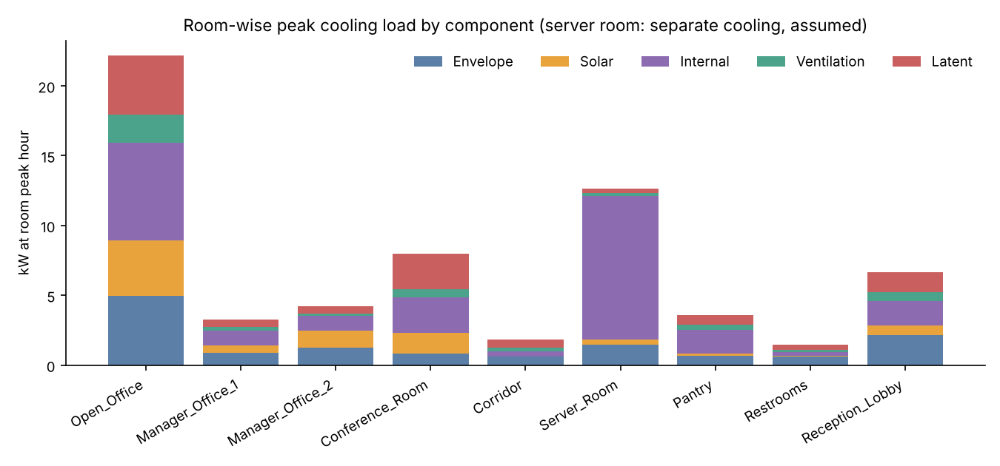
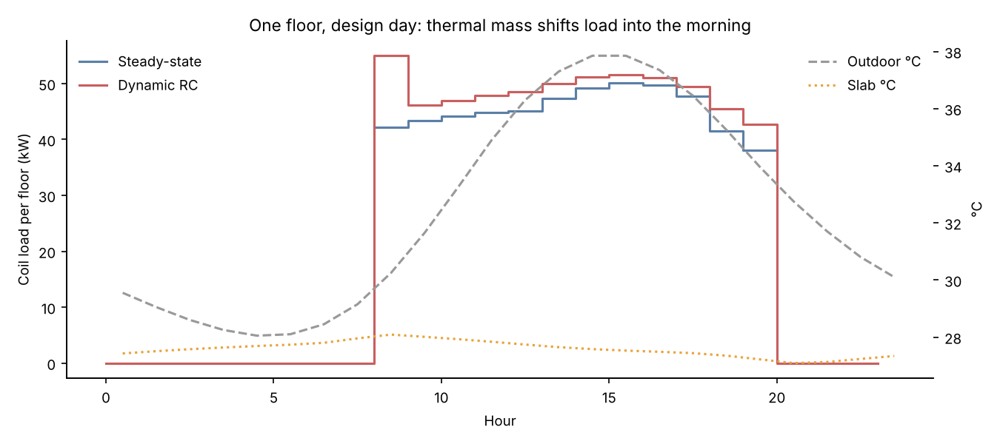
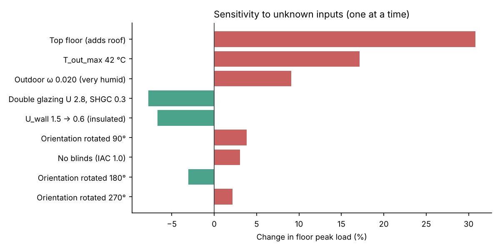
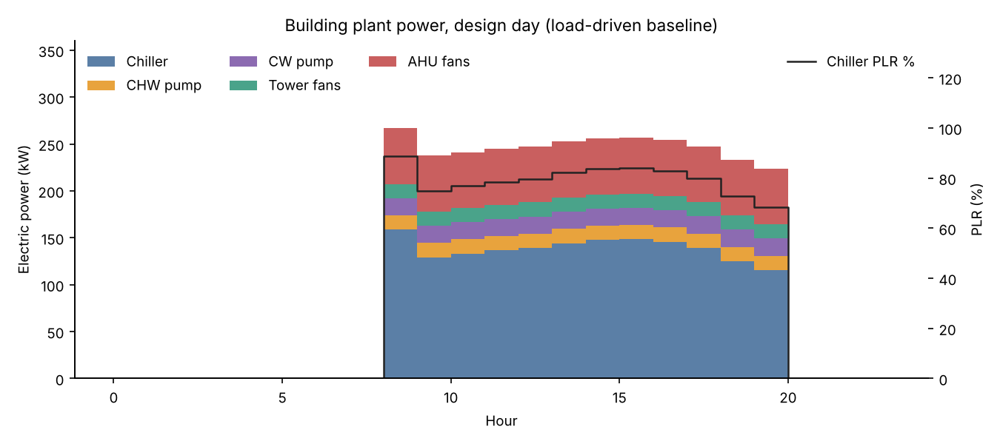

# Stage 2 — Worked hypothetical example

> All inputs are synthetic or assumed. Every number below is a **prediction**, not a measured or validated value.

## 1. Geometry extracted from USDZ

Rooms **9** · floor area **600.0 m²** · volume **1,620.0 m³** · exterior wall **270.0 m²** · windows **56.2 m²** · WWR **20.8%**

Parser output matches the ground-truth file exactly (see `tests/`). Exterior walls were *inferred* from shared-wall geometry; orientation uses the ARKit convention (−Z = north) as an **assumption**.

| Room | Area m² | Volume m³ | Exterior walls (facing) | Window m² |
|---|---:|---:|---|---:|
| Open_Office | 216.0 | 583.2 | N 18 m, W 12 m | 24.30 |
| Manager_Office_1 | 36.0 | 97.2 | N 6 m | 5.40 |
| Manager_Office_2 | 36.0 | 97.2 | N 6 m, E 6 m | 8.10 |
| Conference_Room | 72.0 | 194.4 | E 6 m | 5.40 |
| Corridor | 60.0 | 162.0 | E 2 m, W 2 m | 0.00 |
| Server_Room | 36.0 | 97.2 | S 6 m, W 6 m | 1.20 |
| Pantry | 36.0 | 97.2 | S 6 m | 2.70 |
| Restrooms | 36.0 | 97.2 | S 6 m | 0.96 |
| Reception_Lobby | 72.0 | 194.4 | E 6 m, S 12 m | 8.10 |

## 2. Room-wise cooling loads (steady-state, design day)

Design day: T_max 38.0 °C, range 10.0 K, lat 17.4°N, 21 May, indoor 24.0 °C / 50% RH. Intermediate floor (no roof).

| Room | Type | People | Peak coil kW | Peak hour | W/m² | On chiller? |
|---|---|---:|---:|---:|---:|---|
| Open_Office | office | 21.6 | 22.2 | 16:00 | 103 | yes |
| Manager_Office_1 | manager | 2.0 | 3.3 | 16:00 | 90 | yes |
| Manager_Office_2 | manager | 2.0 | 4.2 | 9:00 | 117 | yes |
| Conference_Room | conference | 18.0 | 8.0 | 9:00 | 111 | yes |
| Corridor | corridor | 0.0 | 1.8 | 15:00 | 30 | yes |
| Server_Room | server | 0.0 | 12.6 | 16:00 | 351 | **no (assumed)** |
| Pantry | pantry | 3.6 | 3.6 | 14:00 | 99 | yes |
| Restrooms | restroom | 0.0 | 1.4 | 14:00 | 40 | yes |
| Reception_Lobby | lobby | 7.2 | 6.7 | 14:00 | 92 | yes |

Sum of individual room peaks **51.1 kW** vs coincident (block) peak **50.1 kW at 15:00**: rooms peak at different times (east-facing in the morning, west-facing in the afternoon). Size AHUs on room peaks, the chiller on the block peak.

**Block load breakdown at 15:00 (kW)**

| wall | window_cond | window_solar | roof | people_s | lights | equipment | infil_s | people_l | infil_l | vent_s | vent_l |
|---:|---:|---:|---:|---:|---:|---:|---:|---:|---:|---:|---:|
| 6.1 | 4.8 | 5.9 | 0.0 | 4.1 | 5.6 | 6.1 | 1.4 | 3.0 | 1.7 | 5.2 | 6.2 |

Latent share **22%**. This is what limits how far CHWS can be raised later.

## 3. Dynamic RC model vs steady-state

C_air 9.2 MJ/K · C_slab 119 MJ/K · slab time constant 9.8 h · envelope conductance 711 W/K

| | Steady-state | Dynamic (RC) |
|---|---:|---:|
| Peak coil load kW | 50.1 | 55.0 (at 8:00) |
| Daily cooling kWh_th | 543 | 586 |
| Slab temp at start-up | — | 28.1 °C |

With the plant off overnight, heat stored in the slab is released next morning: an 8:00 pull-down spike and a higher load all day. Steady-state under-predicts daily cooling by **8%** here.

## 4. How much do the unknowns matter? (one at a time, dynamic model)

| Change | Peak kW | Δ peak | Daily kWh_th | Δ energy |
|---|---:|---:|---:|---:|
| **Baseline** | 55.0 | — | 586 | — |
| Orientation rotated 90° | 57.1 | +4% | 600 | +2% |
| Orientation rotated 180° | 53.3 | -3% | 579 | -1% |
| Orientation rotated 270° | 56.1 | +2% | 601 | +3% |
| U_wall 1.5 → 0.6 (insulated) | 51.3 | -7% | 547 | -7% |
| Double glazing U 2.8, SHGC 0.3 | 50.7 | -8% | 536 | -9% |
| No blinds (IAC 1.0) | 56.6 | +3% | 600 | +3% |
| Outdoor ω 0.020 (very humid) | 60.0 | +9% | 642 | +10% |
| T_out_max 42 °C | 64.4 | +17% | 662 | +13% |
| Top floor (adds roof) | 71.9 | +31% | 761 | +30% |

Orientation is not in the scan, but for this floor it moves the peak by only a few percent. Climate, floor position (roof) and glazing matter far more, so those questions get asked first.

## 5. Scaling to the building: the chiller-size question

One floor peaks at **55 kW (15.6 TR)** but the chiller is **879 kW (250 TR)**. The number of floors is NOT in the scan.

For a working example we **assume 14 identical floors** (13 intermediate + 1 top) → building peak **781 kW (222 TR, 89% of capacity)**, 8,375 kWh_th/day. Gross area 8,400 m² → 38 m²/TR.

⚠ **Placeholder. The engineer must confirm floors served.**

## 6. Chiller plant energy

Part-load curve fitted to the workbook data (CHWS 6 °C, ECWT 29.4 °C): P/P_ref = 0.043 + 0.625·PLR + 0.316·PLR² (R² 0.9995, RMSE 1.0 kW, PLR 0.3–1.0, 8 points).

| | A. Excel method (full load all hours, constant kW/TR) | B. Load-driven (hourly, part-load curve) |
|---|---:|---:|
| Chiller kWh/day | 2,250 | 1,663 |
| CHW pump kWh/day | 183 | 183 |
| CW pump kWh/day | 222 | 222 |
| Tower fans kWh/day | 180 | 180 |
| AHU fans kWh/day | 715 | 715 |
| **Total kWh/day** | **3,549** | **2,962** |
| Cooling delivered kWh_th/day | 10,551 | 8,375 |
| Average plant kW/TR | 1.18 | 1.24 |
| Average chiller kW/TR | 0.75 | 0.70 |
| Annual kWh (360 days) | 1,277,814 | 1,066,470 |
| Annual cost @ 8 INR/kWh | 10,222,514 | 8,531,758 |

In B the chiller averages 79% PLR, but pumps and fans run at full design power regardless → auxiliaries are **44%** of plant energy (vs 37% in A). That constant-speed auxiliary energy is the first optimisation target for Stage 3.

Both columns assume every day is the design day, so annual figures are an **upper bound** until real weather data and schedules are used.

## 7. Open issues the system would raise (priority order)

| Priority | Topic | Issue | Engineer options |
|---|---|---|---|
| HIGH | Floors served | Scan covers 1 floor (600 m²); chiller is 250 TR. Assumed 14 floors to make the numbers consistent. | Enter floors served / Provide whole-building load / Accept assumption |
| HIGH | Envelope | U-values, SHGC and shading are assumed (U_wall 1.5, single tinted glass). | Accept / Enter construction details / Run insulated / double-glazed scenarios |
| HIGH | Server room | Server room needs 24 h cooling (~12 kW) but the chiller runs 12 h/day. Assumed on separate cooling. | Confirm separate CRAC/DX / Include in chiller load (24 h operation) |
| HIGH | Climate & floor position | Site and design conditions are placeholders (+4 °C → +17 % peak); top floor adds +31 %. | Enter city / weather file / Confirm which floor was scanned |
| MEDIUM | Orientation | True north unknown. Floor peak ranges 53.3–57.1 kW over 4 orientations. | Give compass bearing of a façade / Run all 4 as scenarios |
| MEDIUM | Room use | Room function inferred from names; a real scan has no office labels. | Confirm room types |
| MEDIUM | Condenser | Condenser water temperature held at 29.4 °C; really varies with outdoor wet-bulb. | Provide tower approach / BMS data |
| LOW | Simplifications | Interior doors, furniture mass, equation-of-time and wall time-lag ignored. |  |

## 8. Provenance of model parameters

**assumed** 27 · **constant** 9 · **hypothetical** 2 · **usdz** 1

All outputs in this report are **PREDICTED**. None are VALIDATED; that requires the client's spreadsheets and measured BMS data.

## Charts

