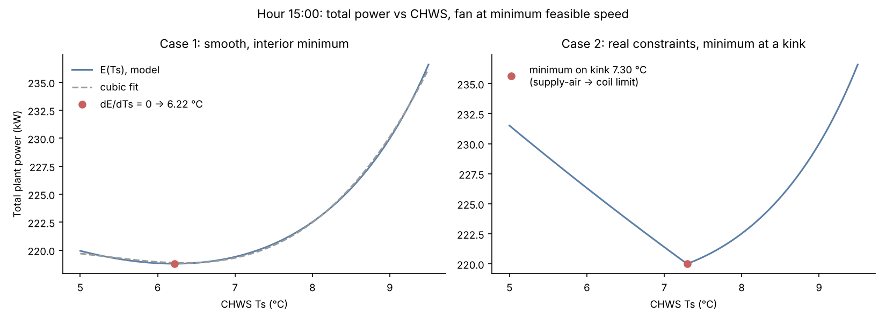
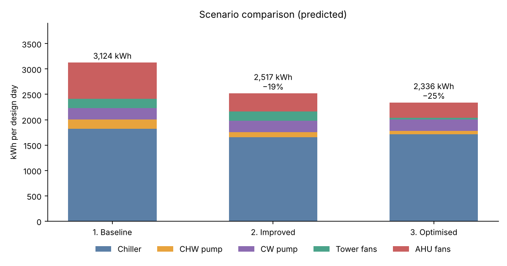
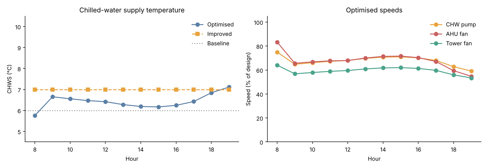
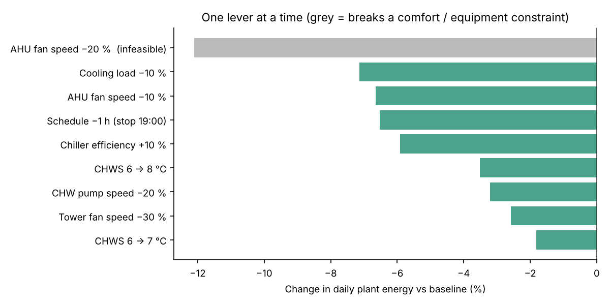

# Stage 3: Optimisation of the chilled-water system

> Building: 14 floors (assumed in Stage 2), design day, 12 operating hours. All results are **predicted** from synthetic data and assumed component models.

## A. Curve fitting: chiller performance model

Model (10-term quadratic regression, L = load in TR, Ts = CHWS, Tc = ECWT):

`P = 47.4 -0.13·L +0.001298·L² +0.8894·Ts +0.1378·Ts² -1.987·Tc +0.02849·Tc² -0.02675·L·Ts +0.02219·L·Tc -0.05185·Ts·Tc`

| Metric | Value |
|---|---|
| Data points | 141 (PLR ≥ 0.26, CHWS 5–10 °C, ECWT 26–32 °C) |
| R² (all data) | 0.9985 |
| RMSE train / hold-out test (28 pts) | 1.63 / 1.87 kW |
| Physics check ∂P/∂Tc > 0 (warmer condenser costs power) | ✅ everywhere |
| Physics check ∂P/∂Ts < 0 (warmer CHW saves power) | ❌ fails on 2% of the domain, only at PLR ≤ 0.3. Regression artefact (the true slope is negative there). Operating loads here are PLR ≥ 0.65, so unaffected. **Production fix: physics-constrained (DOE-2 form) fit.** |

Available capacity: TR = 278.5 + 7.50·Ts -2.50·Tc (exact for this data).

Other component models are physics relations with **assumed** parameters (real data replaces them):

- Coil: ε-NTU counter-flow, UA from film resistances (70 % air-side) scaling with flow^0.8; UA calibrated to 92 kW/K so the coil has a 15% margin at the peak hour
- CHW pump / AHU fan: P = P₀·f·(c + (1−c)f²), c = 0.2 / 0.25 (pressure-setpoint share)
- Tower: approach = 3.5 K × (Q_rej/Q_rej,design) × f_t^−0.6; P = 15 kW × f_t³; wet-bulb from the design day (23.7–25.9 °C)
- Fan heat adds to coil load; pump heat adds to chiller load; heat rejection = load + compressor power

## B. Differentiation: finding the minimum of E(Ts)

Hour 15:00, pump and tower speeds held at fw = 1.0, ft = 0.62. For each Ts the fan runs at the *minimum speed that still meets the coil, humidity and supply-air constraints*, f_a*(Ts). Then

`E(Ts) = P_chiller(Q(Ts), Ts, ECWT) + P_fan(f_a*(Ts)) + P_pump + P_tower`

`dE/dTs = ∂P_ch/∂Ts + (dP_fan/df_a)·(df_a*/dTs) + (fan-heat and ECWT coupling)`

Raising Ts saves compressor power (first term < 0) but cuts coil capacity, so the fan must speed up (second term > 0, growing roughly with f_a²). The minimum is where they balance.

**Case 1: only the coil constraint active** (supply-air limit relaxed to 8 °C):

| Quantity | Value |
|---|---|
| Stationary point dE/dTs = 0 (root-finding on the numerical derivative) | **Ts* = 6.22 °C** |
| Cubic fit of E(Ts), root of its analytic derivative | Ts* = 6.34 °C |
| Second derivative d²E/dTs² at Ts* | **+1.79 kW/K² > 0 → minimum** ✅ |
| E at Ts* / at 6 °C / at 9.5 °C | 218.8 / 218.8 / 236.6 kW |
| Above ≈ 9.5 °C | infeasible: even 100 % airflow cannot meet the coil duty |
| At Ts*: ∂P_ch/∂Ts (analytic, from the regression) | -4.86 kW/K |
| At Ts*: fan + coupling terms | +4.86 kW/K (they cancel) |

**Case 2: real constraints** (supply air ≥ 12 °C also active):

Below Ts ≈ 7.30 °C the fan is pinned by the *supply-air* limit (not the coil), so the fan term is flat and dE/dTs ≈ -4.68 kW/K < 0. Above it the coil binds and dE/dTs ≈ +3.22 kW/K > 0. The minimum sits **on the kink at Ts ≈ 7.30 °C, where dE/dTs does not exist**.

➡ Setting dE/dx = 0 only finds minima where no constraint is active. With active constraints the optimum satisfies the KKT conditions instead. That's why the engine uses a constrained numerical optimiser (SLSQP), verified by brute-force grid search.

## C. Constrained optimisation (per hour)

Minimise P_total(Ts, fw, fa, ft) subject to:

- coil sensible capacity ≥ duty · supply air ≥ 12.0 °C · room RH ≤ 55% (supply dew point ≥ Ts + 4.0 K)
- evaporator ΔT ≤ 9.0 K · chiller load ≤ capacity · PLR ≥ 0.26 · ECWT within data range 26–32 °C
- bounds: Ts 5.0–10.0 °C, pump 50%–100 %, fan 50%–100 %, tower fan 30%–100 %

**Optimiser verification against a brute-force grid (72,765 points):**

| Hour | SLSQP kW | Grid kW | Grid point (Ts, fw, fa, ft) |
|---|---:|---:|---|
| 8:00 | 234.3 | 236.7 | 5.50, 0.70, 0.850, 0.65 |
| 15:00 | 214.2 | 214.7 | 6.50, 0.75, 0.725, 0.60 |

SLSQP is never worse than the grid (the grid is coarser), so the optimum is credible within this model.

**Optimised set-points by hour:**

| Hour | Coil load kW (incl. fan heat) | CHWS °C | CHW pump | AHU fan | Tower fan | ECWT °C | Supply air °C | P_total kW | vs baseline | Binding constraints |
|---|---:|---:|---:|---:|---:|---:|---:|---:|---:|---|
| 8:00 | 819 | 5.76 | 75% | 83% | 64% | 28.0 | 12.0 | 234.3 | -15% | coil, supply_air |
| 9:00 | 682 | 6.65 | 65% | 66% | 57% | 27.8 | 12.0 | 175.5 | -28% | coil, supply_air |
| 10:00 | 699 | 6.55 | 66% | 67% | 58% | 28.3 | 12.0 | 182.9 | -27% | coil, supply_air |
| 11:00 | 714 | 6.47 | 67% | 68% | 59% | 28.8 | 12.0 | 190.0 | -26% | coil, supply_air |
| 12:00 | 725 | 6.42 | 68% | 68% | 60% | 29.2 | 12.0 | 195.1 | -25% | coil, supply_air |
| 13:00 | 748 | 6.28 | 70% | 70% | 61% | 29.6 | 12.0 | 205.5 | -24% | coil, supply_air |
| 14:00 | 763 | 6.19 | 71% | 71% | 62% | 29.9 | 12.0 | 212.5 | -22% | coil, supply_air |
| 15:00 | 766 | 6.17 | 71% | 72% | 62% | 30.0 | 12.0 | 214.2 | -22% | coil, supply_air |
| 16:00 | 754 | 6.24 | 70% | 70% | 61% | 29.9 | 12.0 | 208.8 | -23% | coil, supply_air |
| 17:00 | 725 | 6.43 | 68% | 67% | 60% | 29.6 | 12.0 | 195.8 | -26% | coil, supply_air |
| 18:00 | 659 | 6.85 | 63% | 59% | 56% | 29.0 | 12.0 | 169.0 | -31% | coil, supply_air |
| 19:00 | 616 | 7.11 | 59% | 55% | 53% | 28.5 | 12.0 | 152.8 | -35% | coil, supply_air |

## E. Scenario comparison (design day)

| | 1. Baseline | 2. Improved (rules) | 3. Optimised |
|---|---:|---:|---:|
| Strategy | CHWS 6 °C, all pumps & fans 100 % | CHWS 7 °C, pump flow ∝ load, VAV at 13 °C supply, tower 100 % | hourly SLSQP over 4 set-points |
| Chiller kWh/day | 1,825 | 1,655 | 1,711 |
| CHW pump kWh/day | 183 | 103 | 71 |
| CW pump kWh/day | 222 | 222 | 222 |
| Tower fans kWh/day | 180 | 180 | 38 |
| AHU fans kWh/day | 715 | 358 | 295 |
| **Total kWh/day** | **3,124** | **2,517** | **2,336** |
| Peak demand kW | 277 | 251 | 234 |
| Plant kW/TR (all-in) | 1.21 | 1.01 | 0.95 |
| Saving vs baseline | — | **19.4%** | **25.2%** |
| Annual kWh (360 design days, upper bound) | 1,124,800 | 906,213 | 841,116 |
| Annual saving @ 8 INR/kWh | — | 1,748,702 | 2,269,473 |
| All constraints met every hour | ✅ | ✅ | ✅ |

*Reconciliation with Stage 2:* the Stage 3 baseline (3,124 kWh/day) is higher than Stage 2's 2,962 because fan heat (60 kW) and pump heat (15 kW) are now added to the chiller load, and ECWT follows the wet-bulb instead of being fixed. About 900 kWh of extra heat at COP ≈ 5.5 adds about 160 kWh of chiller energy.

Status of these savings: **PREDICTED** (model-to-model), not validated. Validation needs a measured baseline (BMS / meters), real equipment curves, and a measured trial (IPMVP Option B).

## D. Sensitivity analysis

**D1. One lever at a time, from baseline operation (design-day kWh):**

| Lever | kWh/day | Δ vs baseline | Constraints OK? |
|---|---:|---:|---|
| CHWS 6 → 7 °C | 3,068 | -1.8% | ✅ |
| CHWS 6 → 8 °C | 3,014 | -3.5% | ✅ |
| CHW pump speed −20 % | 3,024 | -3.2% | ✅ |
| AHU fan speed −10 % | 2,917 | -6.7% | ✅ |
| AHU fan speed −20 % | 2,746 | -12.1% | ❌ violates |
| Tower fan speed −30 % | 3,044 | -2.6% | ✅ |
| Cooling load −10 % | 2,901 | -7.1% | ✅ |
| Chiller efficiency +10 % | 2,940 | -5.9% | ✅ |
| Schedule −1 h (stop 19:00) | 2,920 | -6.5% | ✅ |

**D2. What the constraints and model assumptions cost (re-optimised kWh/day):**

| Change | Optimised kWh/day | Δ vs optimised base | Optimised saving vs its own baseline |
|---|---:|---:|---:|
| Supply air min 12 → 11 °C | 2,325 | -0.5% | 25.6% |
| Supply air min 12 → 13 °C | 2,372 | +1.5% | 24.1% |
| RH max 55 → 50 % | 2,336 | -0.0% | 25.2% |
| Min AHU airflow 50 → 70 % | 2,351 | +0.6% | 24.8% |
| Coil 15 % smaller (margin 1.0) | 2,509 | +7.4% | 19.7% |
| Coil 15 % bigger (margin 1.3) | 2,230 | -4.6% | 28.6% |

The supply-air limit and the **coil model** set how far the optimiser can go: coil size moves the saving by about ±4–7 %. The RH limit is not binding on this day because the optimal CHWS stays low; it would bind if the coil were larger or the latent load higher. Coil performance data is the most valuable missing input for optimisation.

## Key findings

1. **Optimised saving 25%** vs baseline; the rule-based retrofit gets 19%. The optimiser's extra comes from coordinating all four set-points.
2. **Optimal CHWS stays low (5.8–7.1 °C).** The usual rule 'raise CHWS to save energy' is outweighed here by the extra fan power the coil then needs. System-level optimisation reverses a component-level intuition.
3. Savings come from **variable speed**: AHU fans 59%, CHW pump 61%, tower fans 79% lower. Chiller energy changes -6%.
4. Binding constraints are mostly **supply-air temperature** and **coil capacity**, i.e. comfort and coil size, not the chiller.
5. Before any set-point is applied, an engineer must approve it and confirm: VFDs actually installed, chiller minimum-flow spec, AHU minimum airflow for ventilation, real coil data.

## Charts

