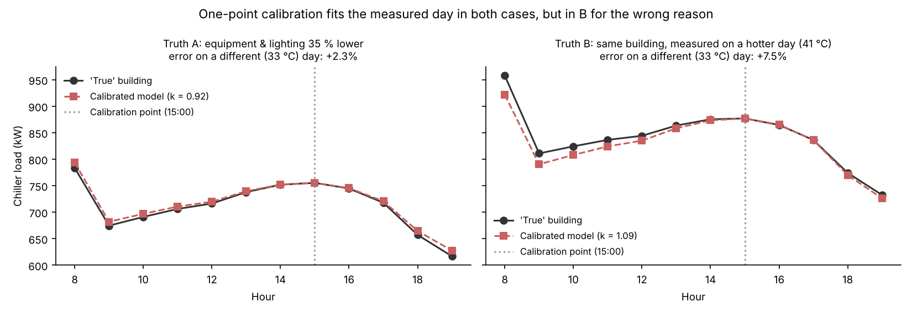

# Stage 5: Experiments behind the critical review

All numbers are generated by `scripts/stage5_review.py` against the same engine as Stages 2–4.

## E1. Does the saving survive contact with the 'true' chiller?

The synthetic data came from a known generator, so the 'truth' is available. The optimiser used the fitted regression. Here both schedules are re-scored on the true chiller.

| | Predicted (regression) | 'True' chiller | Gap |
|---|---:|---:|---:|
| Baseline kWh/day | 3,124 | 3,127 | +0.1% |
| Optimised kWh/day | 2,336 | 2,336 | -0.0% |
| **Saving** | **25.2%** | **25.3%** | +0.1 pp |

Regression error vs truth: ≤ 0.9% in the normal operating region, up to 3.9% at the corners of the data range. **Verdict:** with clean, well-covered data the regression is good enough for optimisation. Real BMS data is noisier, clustered in a narrow operating band, and drifts as the chiller ages, so this is a best case.

## E2. Can one measured point calibrate the model?

Two different 'real' situations both produce a 15:00 chiller load that differs from the model. In each case the model is calibrated on that one reading with a single load multiplier (as in Stage 4). It is then checked (a) over the rest of the same day, and (b) on a different, cooler day (33 °C) where the weather input is correct.

| Truth | Calibration factor | Error at 15:00 | Worst hourly error, same day | Daily error on the 33 °C day |
|---|---:|---:|---:|---:|
| Truth A: equipment & lighting 35 % lower | 0.921 | -0.0% | +1.7% | **+2.3%** |
| Truth B: same building, measured on a hotter day (41 °C) | 1.085 | +0.0% | -3.7% | **+7.5%** |

**Verdict:** within the calibration day a one-point scalar looks fine (errors of a few %), which is exactly why it is dangerous. In Truth B the real cause was *weather*, but the scalar 'learned' that the building is more heavily loaded. That wrong lesson then carries into every other day as a systematic over-prediction, and inflates baselines and claimed savings. A correct calibration must attribute error to the right parameter: measured weather for the same period, many hours across varied days, and separate parameters (internal gains, envelope UA, infiltration) fitted together by least squares or Bayesian methods. Acceptance: ASHRAE Guideline 14 (hourly CV(RMSE) ≤ 30 %, NMBE ≤ ±10 %).

## E3. What if the coil isn't what we assumed?

The optimised schedule was computed for the assumed coil (15 % margin) and is then applied to a different 'real' coil.

| Real coil | Hours violating constraints | Worst coil shortfall | Energy of our schedule | Best possible on that coil |
|---|---:|---:|---:|---:|
| Coil 13 % smaller than assumed (margin 1.00) | 12 / 12 | 86 kW (13% of sensible duty) | 2,336 kWh | 2,509 kWh |
| Coil 13 % larger than assumed (margin 1.30) | 0 / 12 | 0 kW (0% of sensible duty) | 2,336 kWh | 2,230 kWh |

**Verdict:** the optimum sits *on* the coil-capacity constraint, so a weaker real coil leaves rooms under-cooled; a stronger one leaves savings on the table. Open-loop set-points from a model are unsafe. The optimiser should set **targets and limits**, the BMS feedback loops (supply-air and zone temperature) handle the residual, and comfort constraints need a back-off margin sized from model uncertainty.

## E4. How much does one assumed fan parameter matter?

Fan power law P = P₀·f·(c + (1−c)f²). c is the share of fan pressure that doesn't fall with speed (duct static-pressure set-point). It is *assumed*.

| c | Baseline kWh/day | Optimised kWh/day | Saving |
|---:|---:|---:|---:|
| 0.10 | 3,124 | 2,282 | 27.0% |
| 0.25 (used) | 3,124 | 2,336 | 25.2% |
| 0.40 | 3,124 | 2,391 | 23.5% |

**Verdict:** one unmeasured parameter moves the headline saving by several points. Fan power vs speed should come from VFD/BMS trends (kW vs Hz) before any saving is quoted to the client.

