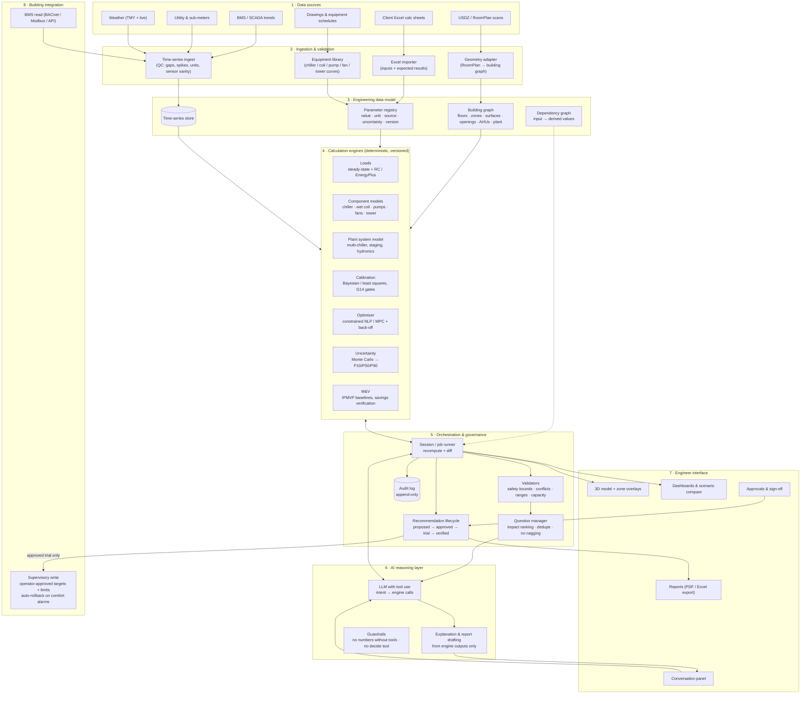
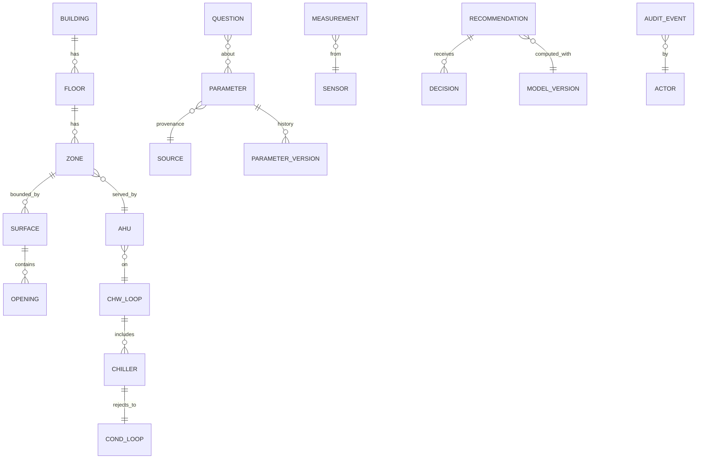
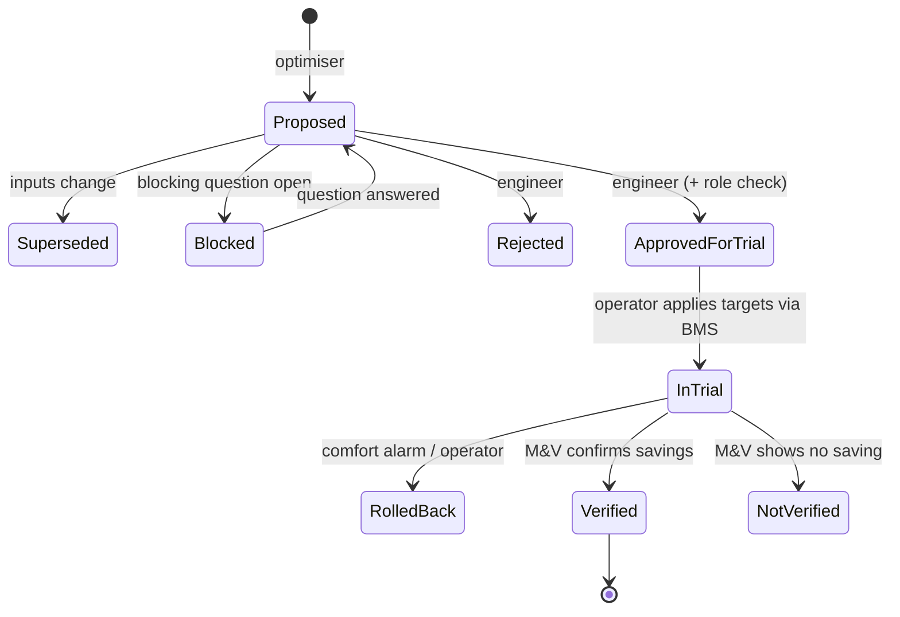

# Stage 6: Implementation architecture

**Intelligent Building Energy Modelling & Optimisation System**

This architecture follows from Stages 1–5, not from a template. Each major decision cites the evidence that forced it.
The prototype code in this repository (`energy_model/`) is the seed of the calculation core, and its modules map onto the components below.

---

## 1. Design principles (and where they come from)

| # | Principle | Evidence |
|---|---|---|
| P1 | **Deterministic engines calculate; the AI interprets, explains and coordinates.** No number reaches the engineer unless an engine produced it. | Brief §5; Stage 4 transcript: every figure traced to an engine call |
| P2 | **Every value carries provenance** (measured / engineer / USDZ / assumed / hypothetical / predicted / validated). | Brief §5; Stage 2 registry: 27 of 39 inputs were assumptions |
| P3 | **The engineer decides.** The AI has no approve/reject capability and no equipment write path. | Brief §6; Stage 4 approval gating |
| P4 | **Optimise the system, not a component**, under explicit comfort and equipment constraints. | Stage 3: raising CHWS helps the chiller but costs the system +4.5 kW |
| P5 | **Supervisory, never open-loop.** Output = targets and limits for the BMS's own feedback loops, with back-off margins and rollback. | Stage 5 E3: a 13 % weaker coil means 12/12 hours under-cooled |
| P6 | **Calibrate parameters, never physics**, and only with enough data to attribute error correctly. | Stage 5 E2: a misattributed one-point calibration biases other days by +7.5 % |
| P7 | **Report uncertainty as ranges.** | Stage 5 E4: one assumed fan parameter moves the saving 23.5–27 % |
| P8 | **Explicit dependency tracking:** when an input changes, show which derived values and assumptions moved. | Stage 5 self-critique: hidden floor-count coupling silently changed a result |
| P9 | **Ask only what matters**, ranked by impact on accuracy, safety and the decision. | Stage 4: wall colour (1.1 %) logged only; design temperature (11.3 %) asked |

---

## 2. System overview

---

## 3. Components

### 3.1 Ingestion & validation

| Component | Responsibility | Prototype today |
|---|---|---|
| Geometry adapter | RoomPlan USDZ → building graph: rooms, surfaces, openings; merge floors; capture heading if available; flag inferred-exterior walls for review | `geometry.py` (synthetic layout only) |
| Excel importer | Read client workbooks into the registry **and** read their results as test oracles | `plant.read_excel_inputs/results` |
| Time-series ingest | BMS/meter/weather import with QC: units, gaps, flat-lines, impossible energy balances | `Session.check_measurement_consistency` (single check) |
| Equipment library | Manufacturer curves (chiller selection data, coil schedules, pump curves, VFD kW-vs-Hz), versioned per asset | `hvac.fit_chiller` (synthetic table) |

### 3.2 Engineering data model

Every `PARAMETER` stores value, unit, **source**, **uncertainty (distribution)**, version and who changed it. Every `RECOMMENDATION` is pinned to the exact model and parameter versions that produced it, so it can be reproduced later.

### 3.3 Calculation engines

| Engine | Method | Status in prototype | Production target |
|---|---|---|---|
| Loads | Hourly heat balance + 2-node RC per floor | `loads.py`, `rc_model.py` | Multi-zone RC; optional EnergyPlus/Modelica co-simulation for detailed studies |
| Components | Regression + physics relations | `hvac.py` | Physics-structured fits (DOE-2/EnergyPlus curve forms), wet-coil ε-NTU, Merkel tower, real pump/VFD curves |
| Plant system | Coupled evaluation with fan/pump heat and ECWT iteration | `optimize.System` | Multi-chiller staging, primary/secondary or variable-primary hydronics, multiple tower cells |
| Calibration | Single scalar | `Session.measure_chiller_load` | Multi-parameter Bayesian calibration over weeks of data; ASHRAE Guideline 14 acceptance gates |
| Optimiser | SLSQP multi-start + grid verification | `optimize.System.optimize` | Constrained NLP per hour → rolling-horizon MPC with rate limits, minimum run times, discrete staging (MINLP or enumerate-and-optimise) |
| Uncertainty | Sensitivity tables | Stage 2/3/5 scripts | Monte Carlo over parameter distributions → savings as P10/P50/P90 |
| M&V | n/a | — | IPMVP Option B/C baselines, trial verification, PREDICTED → VALIDATED transition |

Engines are **pure functions of (inputs, parameter versions, model version)**: no hidden state, cacheable, reproducible, unit-checked (e.g. `pint`).

### 3.4 Orchestration & governance

Already prototyped in `energy_model/session.py`:

- **Recompute with diff:** any change re-runs what depends on it and reports before/after. Production adds the dependency graph so only affected parts re-run, and so derived assumptions that moved are listed.
- **Validators before change:** safety bounds reject unsafe inputs without touching state.
- **Question manager:** priority = SAFETY > CONFLICT > HIGH > MEDIUM > LOW; impact threshold (≥ 2 % energy swing) decides whether to ask; never re-asks unless the situation changed.
- **Recommendation lifecycle:**

- **Audit log:** append-only record of every change, measurement, question, answer, recommendation and decision, with the actor and the engineer's own words.

### 3.5 AI reasoning layer

Prototyped in `energy_model/agent_tools.py` + `scripts/assistant.py`.

| Concern | Design |
|---|---|
| Pattern | LLM with **tool use** over the engine. Tools: status, parameters, questions, set parameter, answer, measurement, consistency check, what-if, explain, show calculation, propose. |
| Hard guardrails (code, not prompt) | No approve/reject tool. `set_parameter` requires the engineer's verbatim quote and goes through engine safety bounds. Strict JSON schemas. Errors returned as tool errors, never swallowed. All tested in `tests/test_stage6.py`. |
| Soft guardrails (prompt) | Numbers only from tool results; state provenance; ask on ambiguity; SAFETY/CONFLICT first; never call predictions validated. |
| What the AI adds | Natural-language intent → the right engine calls; disambiguation ("CHWS 7: keep return or keep ΔT?"); explanations grounded in derivatives and binding constraints; question phrasing; report drafting. |
| Model | Claude Opus 5.5, effort `high`, server-side refusal fallback enabled. |
| Hosting | Prototype: Messages API manual loop in our own service, so tools run next to the engine and client data. Alternative: Anthropic Managed Agents (hosted loop + sandbox) with these as custom tools. Decide on data-residency and ops preferences (§8). |
| Evaluation | A **golden-conversation test suite**: scripted engineer turns with expected engine calls and forbidden behaviours (invented numbers, unauthorised changes, approvals). Run on every prompt or model change. Stage 4's transcript is the first case. |

### 3.6 Engineer interface

Conversation panel next to a **3D model view** (zones coloured by load, comfort risk or data quality); scenario comparison dashboards; question inbox ranked by impact; approval screens showing assumptions, confidence and blockers; exports to PDF and **Excel in the client's own format** (so engineers can check it line by line against their sheets).

### 3.7 Building integration and safety

| Layer | Rule |
|---|---|
| Read | BMS points via BACnet/Modbus/vendor API, read-only by default |
| Write | Disabled by default. When enabled per site: only **targets within engineer-approved limits**, only for an approved recommendation, only by an authorised operator action |
| Run-time protection | Back-off margins on comfort constraints; watchdog on zone temperature/RH and supply-air temperature; **automatic rollback** to the previous set-points on alarm |
| Never | Direct actuation of safety interlocks, chiller start/stop sequences or freeze protection |

---

## 4. Continuous learning: what is learned, and what never is

| Learned (with versioning and audit) | Never learned |
|---|---|
| Calibrated parameters (internal gains, UA, infiltration, equipment degradation) from measured data | Conservation of energy, heat-transfer equations, psychrometrics, affinity laws |
| Refitted equipment curves as assets age | Safety bounds (changed only by an authorised engineering role, with reason) |
| Site-specific constraint defaults engineers keep applying (e.g. "fan ≥ 75 %") → proposed as new defaults, not silently applied | Acceptance criteria for validation |
| Recommendation ranking from approvals, rejections and **measured** trial outcomes | Anything from a correction that contradicts physics: that triggers a data-quality question instead |
| Prediction-accuracy tracking per model and site (residuals, CV(RMSE), NMBE) | |

A correction is first treated as **data** (which parameter could explain it?), then as **calibration** (with enough data to attribute it), never as a change to the equations.

---

## 5. Technology stack (proposal)

| Layer | Choice | Why |
|---|---|---|
| Engines | Python (NumPy/SciPy, `pint` units), current prototype code | Already working and tested; engineering ecosystem |
| Detailed simulation (optional) | EnergyPlus / Modelica via co-simulation | Industry-validated physics where needed |
| Optimisation | SciPy SLSQP → CasADi/IPOPT for MPC; Pyomo for staging (MINLP) | Constrained, gradient-based, scales to horizons |
| API | FastAPI services; job queue (Celery/RQ) for long runs | Async recompute, Monte Carlo batches |
| Data | PostgreSQL (registry, audit, recommendations) + TimescaleDB (time series) + object storage (USDZ, reports) | Relational audit plus efficient trends |
| AI layer | Anthropic SDK, Claude Opus 5.5, tool use | Prototype in place |
| Frontend | React + three.js (USDZ/glTF viewer) | 3D model with overlays |
| Integration | BACnet/Modbus gateway, vendor APIs; read-only first | Plant-side safety |
| Ops | Containers, CI with the regression and golden-conversation suites, role-based access, encrypted secrets | Reproducible and auditable |

---

## 6. Phased roadmap

| Phase | Goal | Key deliverables | Exit criterion |
|---|---|---|---|
| **0 · Prototype** ✅ | Prove the method | This repository: engine, optimiser, session, AI tool layer, 23 tests | Done (synthetic data) |
| **1 · Validate the core** | Match the client's engineering | Import the client's Excel sheets as test oracles; one real building's drawings, equipment schedules, ≥ 4 weeks of BMS trends | Python reproduces client sheets exactly; model meets ASHRAE G14 on measured data |
| **2 · Real plant physics** | Close the realism gaps from Stage 5 | Multi-chiller staging, wet coil, tower cells, physics-structured curve fits, multi-parameter calibration, Monte Carlo ranges, annual weather runs | Savings reported as P10–P90; calibration holds on held-out weeks |
| **3 · Engineer pilot (advisory only)** | Put the assistant in front of engineers | Web UI, AI assistant, question inbox, approvals, reports; golden-conversation eval suite | Engineers use it on live projects; zero unsupported numbers in eval |
| **4 · Supervised trials** | Turn predictions into evidence | Operator-applied targets, comfort watchdog and rollback, M&V per IPMVP | First **VALIDATED** saving on a real plant |
| **5 · Scale & learn** | Many buildings | Portfolio views, asset-level curve refits, recommendation ranking from verified outcomes | Prediction accuracy tracked and improving across sites |

---

## 7. Key risks and mitigations

| Risk | Mitigation |
|---|---|
| AI states a number the engine did not produce | Tool-only numbers rule, golden-conversation evals, UI shows the engine call behind each figure |
| Savings over-promised from assumptions | Provenance labels, P10–P90 ranges, PREDICTED vs VALIDATED status, M&V before any claim |
| Unsafe operation from model error | Supervisory-only, back-off margins, watchdog + rollback, human approval, no safety-interlock access |
| Wrong calibration attribution | Multi-parameter calibration, held-out validation, weather-normalised data |
| Real scans differ from the synthetic layout | Geometry adapter with engineer review of inferred exterior walls and floors |
| Hidden coupling between assumptions | Dependency graph; recompute diff lists derived assumptions that changed |
| Client data security | Encryption, role-based access, data stays in the client's region; choose AI hosting accordingly |

---

## 8. Decisions needed from the team

1. **First pilot building:** which site can supply drawings, equipment schedules and ≥ 4 weeks of BMS trends?
2. **Client Excel sheets:** when can we get them, to use as validation oracles?
3. **AI hosting:** our own service calling the Claude API (prototype), or Anthropic Managed Agents (hosted loop)? This depends on data-residency and ops preferences.
4. **BMS integration scope:** read-only for the pilot (recommended), or supervisory write in Phase 4?
5. **Detailed simulation:** is EnergyPlus co-simulation needed for client deliverables, or is the RC model enough?

---

## Appendix: prototype → production map

| Prototype file | Becomes |
|---|---|
| `energy_model/geometry.py` | Geometry adapter |
| `energy_model/climate.py`, `loads.py`, `rc_model.py`, `pipeline.py` | Loads engine |
| `energy_model/hvac.py` | Component-model engine + equipment library |
| `energy_model/optimize.py`, `scenarios.py` | Plant system model + optimiser |
| `energy_model/plant.py` | Excel importer / validation oracle |
| `energy_model/provenance.py`, `defaults.py` | Parameter registry |
| `energy_model/session.py` | Orchestration: recompute, validators, questions, lifecycle, audit |
| `energy_model/agent_tools.py`, `scripts/assistant.py` | AI reasoning layer |
| `scripts/engineer_cli.py` | Stand-in for the engineer UI |
| `tests/` | Regression suite (seed of CI) |
